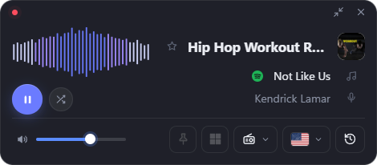
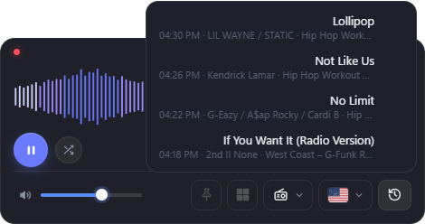

# Radio Widget

[](https://github.com/MoshikoKar/radio-widget/actions/workflows/release.yml) [](https://github.com/MoshikoKar/radio-widget/releases/latest)

A small internet radio widget for Windows. It plays thousands of stations from [radio-browser.info](https://www.radio-browser.info), shows the song and artist when the station sends them, and stays out of the way on your desktop. It runs in the tray and has no taskbar button.

<p align="center">
  <br>
  <br>
  
</p>

Built with [Tauri 2](https://tauri.app). The backend is Rust and the UI runs in WebView2, which ships with Windows. The installer is about 1.4 MB. In Task Manager the widget (with its WebView2 processes) uses about 30 MB while it sits in the tray, and more while it's on screen.

## Download

Get the latest `RadioWidget_x.y.z_x64-setup.exe` from [**Releases**](https://github.com/MoshikoKar/radio-widget/releases/latest).

- It installs for the current user only, so you don't need admin rights.
- Every release is built and published by GitHub Actions. The files aren't code-signed, so Windows SmartScreen may warn you the first time. Click **More info**, then **Run anyway**.
- Once installed, the app updates itself from the tray menu (see **Updates** below). Versions before 0.5.8 don't have this: install 0.5.8 over them once by hand.
- After installing, look for the widget's icon in the tray next to the clock.
- It needs WebView2. Windows 11 and an up-to-date Windows 10 already have it. If it's missing, the installer downloads it.

## Features

| | |
|---|---|
| **Expanded** | Shown at launch. Visualizer, logo, station name with a favorite ★, song and artist (click either to copy "Artist - Song"), play/pause, a shuffle button for a random station, volume, stay-on-top, start with Windows, station dropdown with search, and a country dropdown of flags |
| **Compact** | Turns on after 20 s idle when stay-on-top is off. Has expand, volume, a visualizer (hover shows artist and song, click copies them), the logo (click it to pick a station) and play/pause. It stays compact until you click expand |
| **Logo** (stay-on-top) | Turns on after 6 s idle when stay-on-top is on. A semi-transparent logo that stays on top. Drag it to move it. Hover or click opens Expanded (right-click to choose which), at the spot where you last left it. Expanded goes back to the logo after 6 s idle |
| **Widget, not app** | No taskbar button. A tray icon has Play/Pause, Show/Hide, Stay on top, Start with Windows, the ad and call volume settings, updates, and Quit. Its tooltip shows the station and song. × hides the widget and the music keeps playing |
| **Windows media controls** | The volume flyout and lock screen show the song, artist and station, with cover art when the station sends it. The keyboard's media keys play/pause, and next/previous step through your favorites (or the country's stations if you have none) |
| **Spotify** | The Spotify icon next to the song searches for it in the Spotify app, or on open.spotify.com if the app isn't installed. It's hidden when there's no song title, or when the station sends a show name, promo, ad code, phone number or its own name/frequency instead |
| **Recently played** | The clock button lists the last 10 songs with time, artist and station. A song is added once it has played for 20 s, so jingles and quick switches stay out. Click a row to copy it, or its Spotify icon to open it |
| **Quieter ads** | When the station marks an ad break (an ad-server marker, or a title that is only "Advertisement" / "פרסומות" and the like), the volume fades to 30/50/70% of the current volume and comes back when the music returns. Talk, empty titles and the station name never count as ads |
| **Quieter calls** | While another app (Teams, Zoom, WhatsApp, Discord…) uses the microphone, the volume fades to 30/50/70% of the current volume and comes back when the call ends. Moving the volume or clicking the "volume lowered" line during an ad or call restores it until that ad break or call is over. For full control, set Windows' Sound → Communications to "Do nothing" so Windows doesn't also lower the radio |
| **Ctrl+Alt+R** | Brings the widget to the front, or hides it if it already has focus. Falls back to Ctrl+Shift+Alt+R if Ctrl+Alt+R is taken |
| **Positions** | Each mode remembers its own screen spot |
| **Random station** | The shuffle button next to play picks a station at random from any of the countries, skipping ones it picked recently. The flag and station list follow it to its country |
| **Dead stations** | A station that hasn't started playing within 15 s, or whose stream fails, is skipped for a random station, with a short message saying so. After 5 dead stations in a row it stops and shows the error. Nothing is skipped while Windows has no network |
| **Updates** | About 15 s after launch, and once a day while it runs, the app checks GitHub for a new release. When there is one, a green dot appears on the tray icon and a Windows notification asks (once per version) whether to update now. Update downloads the installer, updates in place and starts the widget again; Later leaves the dot and a "● Update now to version x.y.z" item in the tray menu for later. Your settings stay. The update is only installed if its signature matches the key built into the app. "Check for updates" in the tray checks right away and always answers with a notification: the update, "latest version", or a failed check with Retry. The portable exe can't update itself: it opens the release page instead |
| **Favorites** | ★ on a station row or next to the station name. Favorites appear at the top of the station list, whatever country is selected |
| **Countries** | 🇮🇱 🇺🇸 🇬🇧 🇨🇦 🇦🇺 🇮🇪 🇳🇿 🇿🇦 to start with. Add or remove any country in Settings → Countries (every country that has stations is listed, with a search box) |
| **Settings** | The gear button left of the volume (expanded mode), or "Settings…" in the tray menu, opens a small settings window: your countries, the ad and call volume, and updates (check, see the result, update now). Click the gear again to close it. The window is created when opened and destroyed when closed, so it uses no memory in between |
| **Song info** | Read from ICY stream metadata through the local proxy (iHeart's extended `text="…"` titles included). Stations that send nothing, only filler text, or titles their server already turned into "???", show "Station doesn't share song info" (in Hebrew when Windows is set to Hebrew) |

The pointer resting on the widget counts as use, so the widget won't collapse under the cursor.
Timings are at the top of `src/renderer.js` (`IDLE_TO_COMPACT_MS`, `IDLE_TO_LOGO_MS`, `LOGO_HOVER_DELAY_MS`).

Settings are stored in `%APPDATA%\com.moshiko.radiowidget\settings.json`.
## Development

You need:
- Rust stable, with the MSVC toolchain
- Visual Studio 2022 Build Tools with the "Desktop development with C++" workload
- Node.js, which is only used for the Tauri CLI

```bash
npm install
npm run dev      # run with live reload
npm run build    # writes the NSIS installer to src-tauri/target/release/bundle/nsis/
```

`src-tauri/target/release/radio-widget.exe` also works on its own as a portable exe.

## Releasing

1. Bump the version in `package.json`, `src-tauri/Cargo.toml` and `src-tauri/tauri.conf.json`.
2. Write the release's changes in `.github/release-notes/vX.Y.Z.md` (optional). If you retake the screenshots, save them under new names (GitHub caches README images by URL).
3. Commit, then tag and push: `git tag vX.Y.Z && git push origin main vX.Y.Z`.

The [Release workflow](.github/workflows/release.yml) tests and builds the app and publishes the installer, the portable exe and `latest.json` to Releases. `latest.json` is what installed apps check for updates. It carries the installer's signature, made with the update key in the `TAURI_SIGNING_PRIVATE_KEY` repository secret. The matching public key is in `tauri.conf.json`. If the secret is missing, the release build fails rather than publish an update nobody can install. Keep a copy of the private key: without it, installed apps can't be updated any more.

## Privacy

The app connects to [radio-browser.info](https://www.radio-browser.info) to list stations, and to the stream of the station you play. Clicking the Spotify icon opens Spotify with a search for the song. It checks GitHub for a new release about once a day (a plain download of `latest.json`, nothing about you is sent). It sends nothing else anywhere: no accounts, analytics or telemetry. Settings stay on your PC in `%APPDATA%\com.moshiko.radiowidget`.

## Layout

- `src/` contains the UI (plain HTML/CSS/JS, no bundler). `bridge.js` maps the UI's `window.radio` API onto Tauri `invoke` and events.
- `src-tauri/src/main.rs` handles the window modes and geometry, tray, global hotkey, autostart, settings and commands.
- `src-tauri/src/proxy.rs` is the local stream proxy. It strips ICY metadata and emits `metadata` events, including explicit ad markers.
- `src-tauri/src/calls.rs` watches the capture devices for apps using the microphone and emits `call` events.
- `src-tauri/src/http.rs` is a minimal HTTP/1.1 client. It accepts SHOUTcast `ICY 200 OK` replies and uses Windows TLS (SChannel).

## Future: song recognition

Some stations send no song title in the stream. The plan is to recognize the song from the audio, the way Shazam does:
- The proxy (`src-tauri/src/proxy.rs`) already has the stream bytes, so it can send a short audio sample (about 10 s) to a recognition service.
- Recognition only runs for stations that send no song info.
- After a song is recognized, it runs again only once that song should have ended.

## License

[MIT](LICENSE). Third-party components and their licenses are listed in [THIRD-PARTY-NOTICES.md](THIRD-PARTY-NOTICES.md).

## Credits

- Station directory: [radio-browser.info](https://www.radio-browser.info)
- Flags: [flag-icons](https://github.com/lipis/flag-icons) (MIT)
