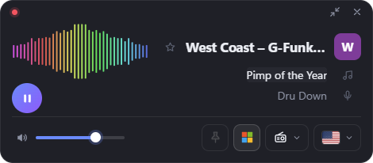

# Radio Widget

A small internet radio widget for Windows. It plays thousands of stations from [radio-browser.info](https://www.radio-browser.info), shows the song and artist when the station sends them, and stays out of the way on your desktop. It runs in the tray and has no taskbar button.

<p align="center">
  <br>
  
</p>

Built with [Tauri 2](https://tauri.app). The backend is Rust and the UI runs in WebView2, which ships with Windows. The installer is about 1.4 MB.

## Download

Get the latest `RadioWidget_x.y.z_x64-setup.exe` from [**Releases**](https://github.com/MoshikoKar/radio-widget/releases/latest).

- It installs for the current user only, so you don't need admin rights.
- The installer isn't code-signed, so Windows SmartScreen may warn you the first time. Click **More info**, then **Run anyway**.
- After installing, look for the widget's icon in the tray next to the clock.
- It needs WebView2. Windows 11 and an up-to-date Windows 10 already have it. If it's missing, the installer downloads it.

## Features

| | |
|---|---|
| **Expanded** | Shown at launch. Visualizer, logo, station name with a favorite ★, song and artist (click either to copy "Artist - Song"), play/pause, volume, stay-on-top, start with Windows, station dropdown with search, and a country dropdown of flags |
| **Compact** | Turns on after 20 s idle when stay-on-top is off. Has expand, volume, a visualizer (hover shows artist and song, click copies them), the logo (click it to pick a station) and play/pause. It stays compact until you click expand |
| **Logo** (stay-on-top) | Turns on after 6 s idle when stay-on-top is on. A semi-transparent logo that stays on top. Drag it to move it. Hover or click opens Expanded (right-click to choose which). Expanded goes back to the logo after 6 s idle |
| **Widget, not app** | No taskbar button. A tray icon has Play/Pause, Show/Hide, Stay on top, Start with Windows and Quit, and its tooltip shows the station and song. × hides the widget and the music keeps playing |
| **Ctrl+Alt+R** | Brings the widget to the front, or hides it if it already has focus. Falls back to Ctrl+Shift+Alt+R if Ctrl+Alt+R is taken |
| **Positions** | Each mode remembers its own screen spot |
| **Favorites** | ★ on a station row or next to the station name. Favorites appear at the top of the station list, whatever country is selected |
| **Countries** | 🇮🇱 🇺🇸 🇬🇧 🇨🇦 🇦🇺 🇮🇪 🇳🇿 🇿🇦. To change them, edit `COUNTRIES` in `src/renderer.js` and add the flag SVG to `src/flags/` and `flags.css` |
| **Song info** | Read from ICY stream metadata through the local proxy. Stations that send nothing, or only filler text, show "Station doesn't share song info" (in Hebrew when Windows is set to Hebrew) |

The pointer resting on the widget counts as use, so the widget won't collapse under the cursor.
Timings are at the top of `src/renderer.js` (`IDLE_TO_COMPACT_MS`, `IDLE_TO_LOGO_MS`, `LOGO_HOVER_DELAY_MS`).

Settings are stored in `%APPDATA%\com.moshiko.radiowidget\settings.json`.
## Development

You need:
- Rust stable, with the MSVC toolchain
- Visual Studio 2022 Build Tools with the "Desktop development with C++" workload
- Node.js, which is only used for the Tauri CLI

```bash
npm install
npm run dev      # run with live reload
npm run build    # writes the NSIS installer to src-tauri/target/release/bundle/nsis/
```

`src-tauri/target/release/radio-widget.exe` also works on its own as a portable exe.

## Layout

- `src/` contains the UI (plain HTML/CSS/JS, no bundler). `bridge.js` maps the UI's `window.radio` API onto Tauri `invoke` and events.
- `src-tauri/src/main.rs` handles the window modes and geometry, tray, global hotkey, autostart, settings and commands.
- `src-tauri/src/proxy.rs` is the local stream proxy. It strips ICY metadata and emits `metadata` events.
- `src-tauri/src/http.rs` is a minimal HTTP/1.1 client. It accepts SHOUTcast `ICY 200 OK` replies and uses Windows TLS (SChannel).

## Future: song recognition

Some stations send no song title in the stream. The plan is to recognize the song from the audio, the way Shazam does:
- The proxy (`src-tauri/src/proxy.rs`) already has the stream bytes, so it can send a short audio sample (about 10 s) to a recognition service.
- Recognition only runs for stations that send no song info.
- After a song is recognized, it runs again only once that song should have ended.

## Credits

- Station directory: [radio-browser.info](https://www.radio-browser.info)
- Flags: [flag-icons](https://github.com/lipis/flag-icons) (MIT)
